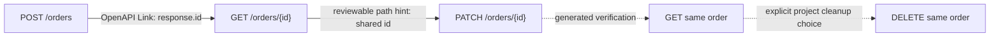

# Business scenario generation from OpenAPI

`BusinessScenarioGenerator` turns a parsed OpenAPI document and explicit project
operation choices into an operation graph and editable business-security drafts.
It sends **no traffic**, obtains no credentials, and earns no security coverage.
A resolved graph link describes a structural relationship, never a passed
security check or an inferred business permission.



## Entry point

```java
var seed = new BusinessScenarioSeed(
    "protected-price", "v1", BusinessSecuritySuite.Kind.PROPERTY_WRITE,
    "POST /orders", "PATCH /orders/{id}",
    "owner", "owner", List.of(), "DELETE /orders/{id}");
var report = generator.generate(parsedDocument, List.of(seed));
```

Reuse the existing discovery parser/registry for `parsedDocument`. The live
example loads `classpath:security/orders-linked.openapi.json` through
`OpenApiSpecParser`. The generator itself performs no URI/file reference fetch;
any resolution performed earlier by the configured discovery parser remains
that parser's separate responsibility. Document servers, Link server overrides
and external operation references never select execution targets.

Seed operation keys are `METHOD /templated/path`. Roles and version are explicit
non-sensitive project aliases. `via` optionally names intermediate operation keys
when different shortest chains would otherwise be ambiguous. Parallel response
branches to the same operation still require a narrowed source document or a
manually reviewed policy; a waypoint does not select a response branch.

## Graph resolution

| Source | Treatment |
|---|---|
| `operationId` | Resolve only a unique ID in this document |
| `operationRef` | Local `#/paths/.../method` JSON Pointer only |
| Link `$ref` | Local `#/components/links/...`, cycle/depth bounded |
| `$response.body#/pointer` | Add a response capture, bind the target parameter or whole JSON body |
| `$request.path.name`, `$request.query.name` | Reuse the preceding request's declared binding |
| Qualified `path.id`, `query.id` target names | Select the declared target parameter location |
| Unqualified target parameter | Resolve only if its path/query location is unambiguous |
| Same entity path / action parent | Optional heuristic edge, always marked `needs_review` |
| Literals, header expressions, request-body expressions, embedded expressions | No value copied; project binding needed |
| External/cyclic references, server overrides, non-specific or non-2xx response branches | Blocked edge, never used to select a chain |

Only supported path/query parameter expressions and whole-body expressions are
translated. JSON Pointer fields use bounded structural names/array indices;
unsupported escaped field names are left for project policy. Graph/report
metadata never contains source examples, defaults, literal Link payloads,
descriptions, credentials or observed values.

Search uses bounded breadth-first traversal and never guesses between equally
short chains. Cycles cannot cause unbounded search. Operation/link/chain/draft
limits fail explicitly, without silently truncating a graph and implying
completeness. Paths must be structural, at most 512 characters, with route
segments/parameter names rather than embedded literal identifiers. Generation
supports JSON request bodies; required arbitrary headers/cookies and non-JSON
bodies block a draft rather than generating an unsatisfiable request.

```yaml
forge:
  security:
    scenarios:
      max-operations: 500  # maximum configurable value: 5000
      max-links: 2000      # maximum: 10000
      max-chain: 8         # operation count, maximum: 30
      max-drafts: 50       # maximum: 500
      path-hints: true     # false requires explicit links for chains
```

## Drafts and review

Output under `forge.security.output-dir/scenario-drafts`:

- `business-scenario-drafts.json`: graph, draft status, required inputs/review;
- `business-scenario-drafts.md`: human-readable chain/status overview;
- `<id>-draft.json`: a suite-shaped template, or a blocked marker.

All files register through ArtifactSink under `business-scenarios` with
`measured=false`. These are generated artifacts, not editable source policies:
copy a template to project test resources before reviewing it. Regeneration
replaces its managed files; blocked drafts overwrite the prior file with a
non-executable marker. On a generation exception, abort the consumer rather
than reusing files from an earlier successful invocation.

Draft status is always `needs_review` or `blocked`. Expected status sets are
empty, so a generated suite cannot be deserialized into executable policy until
the project fills them. Persisted-state assertions are also empty and the
business executor refuses write cases without them. Nothing is automatically
accepted, baseline-promoted or counted as measured/excluded.

Review explicitly supplies:

1. Expected statuses for controls, probes, verification and cleanup, including
   the successful response branch used by a Link.
2. Payload/fixture inputs named by `${input_...}` placeholders. Entire JSON
   values retain their type; no data is copied from schema examples/defaults.
3. Protected fields, allowed business states and persisted-state invariants.
   The owner-control step captures `before` as a possible comparison input;
   whole-object equality is not assumed or inserted as a business rule.
4. Owner/actor role permissions, distinct tenant aliases for tenant cases, and
   the correctness of path-derived relationships and shared bindings.
5. Coverage/exclusions for the full supplied document × actor × kind matrix.
6. Explicit disposable-fixture cleanup. Write chains require a seed-selected
   matching DELETE operation; it is not selected or run implicitly. Projects
   with other cleanup mechanisms can author a policy directly instead.

The generator inserts an owner GET using the **probe's** bound fixture ID, then
the role-specific probe. Replay adds an identical successful first request and
captures state afterward. If any setup/probe writes, a final owner GET must have
reviewed state assertions. Setup controls can create a resource at a collection
URL and feed its captured ID into entity reads; these positive setup writes
are distinct from the negative probe whose effects are checked. A final state
read must match the last write probe (or the primary read probe when only setup
wrote). Later writes after the probe retain the same strict verification guard.

After review, deserialize the template as `BusinessSecuritySuite`, provide the
runtime `Map<String, JsonNode>` inputs, and call `BusinessSecurityRunner.run`.
Execution still needs its own test-environment opt-in, host allowlist, write
switches and bounds. `SecurityRunner.assertAcceptable()` remains the gate;
generation alone cannot satisfy an enabled business block. Existing fixtures,
policies and sources of ownership/tenant truth remain project responsibilities.

## Verification

`BusinessScenarioGeneratorTest` covers references, cycles, ambiguous paths,
waypoints, body/query transfers, replay structure, bounded work and privacy.
`BusinessScenarioGenerationExampleTest` parses the real local OpenAPI fixture,
reviews drafts, creates fresh orders, captures IDs, checks field/object access,
verifies persisted state and deletes its fixtures. The same reviewed policies
pass the secure local API and detect the intentionally vulnerable one.
The independent published-library consumer also resolves the generator bean
and proves generation cannot turn an unmeasured gate into a pass.

OpenAPI Link semantics: [OpenAPI 3.0.3 Link Object](https://spec.openapis.org/oas/v3.0.3.html#link-object).
